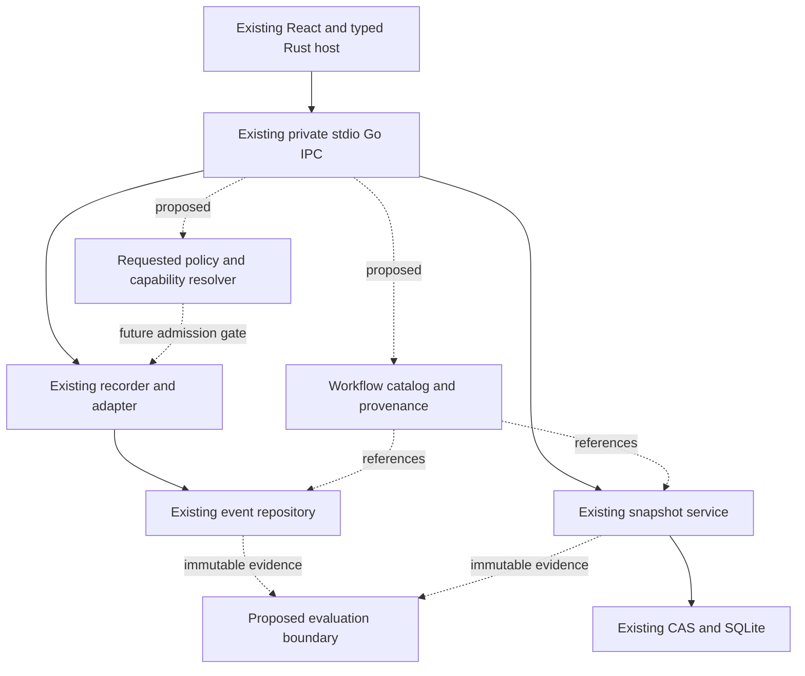
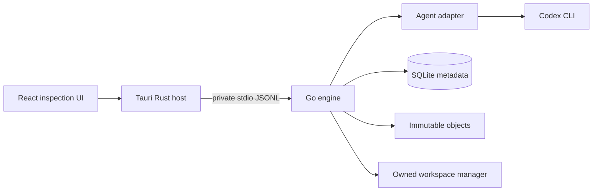

# Architecture

## Phase 4D implemented storage adapter

The existing SQLite Store now implements AdmissionRepository internally. Storage owns versioned JSON envelopes, revision/idempotency/uniqueness constraints and recovery; admission remains a pure domain package. Startup Open performs admission validation/recovery after migrations, but recorder/adapter/supervisor do not consume or create admissions. Migration 3 is the only format advancement; engine/protocol/event/run/manifest/policy/domain versions and public capabilities are unchanged. See [Phase 4D status](IMPLEMENTATION_STATUS_PHASE_04D.md).

## Phase 4C internal contracts only

Phase 4C adds an unconnected internal/admission domain package for immutable canonical bindings and pure transition values. It reuses policy types and has no storage, clock, process, UI or provider dependency. It is not imported by the recorder/supervisor path; their existing behavior and conservative refusal remain unchanged. See the [Phase 4C report](IMPLEMENTATION_STATUS_PHASE_04C.md) and [canonical specification](SYSTEM_DESIGN.md).

## Phase 4B audit and proposed admission boundary

Existing Phase 4A is unchanged: internal policy assessment is pure, ConservativeProvider supplies unknown evidence, and supervisor policy requests always refuse before setup. Existing adapter.Version and adapter.Record both launch through the legacy nil-policy path; the version check is also an execution requiring future binding. Recorder creates run metadata before those operations. No admission repository, approval identity, launch plan, trusted positive provider or backend exists.

Proposed internal/admission coordinates immutable launch binding, trusted evidence, approved identity, durable one-use claim and backend launch. It depends on repository/provider/backend ports; it does not trust the frontend or replace event history. Existing storage lease/transactions support claims but cannot atomically start OS processes. A separate attempt record distinguishes authorization from observed start. Recorder/adapter will need an explicitly reviewed launch-planning boundary before positive integration; no generic callback accepting a satisfied result should bypass the supervisor.

Active versions remain engine 0.3.0, protocol 1, event 2, run 1, manifest 1, internal policy 1 and SQLite migrations 1–2. The [launch protocol](SYSTEM_DESIGN.md), [persistence proposal](DATA_MODEL.md) and [ADR-0007](decisions/ADR-0007-durable-admission-launch-binding.md) are designs, not shipped functionality. No new dependency/framework is needed for the proposed pure domain/storage slices; backend dependencies remain undecided.

## Phase 4A implemented core

Go internal/policy now evaluates typed supplied evidence independently of providers and host facilities. The supervisor has an internal opt-in policy request that always refuses before process setup using unknown conservative evidence. Existing Codex/IPC/UI launches remain legacy and are not policy-verified. No positive enforcing provider, backend, workflow or evaluator is added.

See [Phase 4A status](IMPLEMENTATION_STATUS_PHASE_04A.md) for exact scope, contract semantics, verification and remaining gates. Earlier Phase 4 sections below describe the original design milestone; proposed backends and positive admission remain unimplemented.

## Phase 4 audit and proposed evolution

Audit date: 2026-10-22. The workspace has no Git repository; source hashes provide a documentation-only change check. The current engine is 0.3.0, IPC protocol 1, recorded event schema 2, run metadata 1, snapshot manifest 1, and SQLite migrations 1–2. Historical proposed event-v1 files are not the recorder format.

| Existing boundary and evidence                                                         | Keep unchanged                                                                                             | Missing / proposed extension                                                                                               |
| -------------------------------------------------------------------------------------- | ---------------------------------------------------------------------------------------------------------- | -------------------------------------------------------------------------------------------------------------------------- |
| Go `model`, `adapter.Adapter.Version/Record`, `adapter/codex`                          | Typed normalized observations; upstream parsing outside core                                               | Participant identity and provider capability descriptors; Claude is absent and current event validation accepts only Codex |
| `recorder`, `supervisor`, `workspace`                                                  | One active run, consent, local sequence, bounded output, POSIX cancellation, metadata observation          | Workflow scheduling and enforced filesystem/network isolation are absent                                                   |
| `storage.Repository` Create/Save/Append/GetRun; `Inspector` bounded query/detail ports | SQLite transactions, checked migration ledger, lease, recovery and payload integrity                       | Add a separate workflow repository port when authorized; do not replace event repository                                   |
| `snapshot.Repository/Objects`, `objects`, `storage/snapshots.go`                       | Exact-byte CAS, manifest validation, idle guard, owned independent restore, ancestry and retained failures | No new workspace abstraction or object format needed for correlation                                                       |
| Go `ipc`, Rust typed commands and serialized `bridge.rs`                               | Private framed stdio, capability handshake, bounded request/reply; no local listener                       | Future allowlisted workflow/policy/evaluation commands need separate contracts and approval                                |
| React `App.tsx`, `Snapshots.tsx`, `api.ts`                                             | Consent/start/cancel, paged timeline and lazy detail, capture/verify/materialize/inventory                 | No workflow graph, policy resolver or evaluation UI exists                                                                 |
| Existing Go, contract, component, process and Rust bridge tests                        | Synthetic fixtures, offline execution; retain all tests                                                    | Native GUI and adversarial isolation acceptance remain open                                                                |

Proposed additions are Go domain services over existing ports: a workflow catalog for membership and provenance; a pure policy resolver plus a separately approved backend capability provider; an evaluation evidence reader and result repository. Evaluation execution would use the same future policy admission boundary as agent execution. None is added in this milestone. No framework or dependency change is proposed.

Solid edges describe existing boundaries; dotted edges are design only. The catalog does not launch runs. An observed handoff does not authorize a child execution. The host stays thin; Go domain services depend on ports, not provider wire types or UI modules. See [workflow ADR](decisions/ADR-0005-workflows-evaluation.md) and [policy ADR](decisions/ADR-0006-execution-policy.md).

## Implemented Phase 3 architecture (2026-10-22)

This section supersedes earlier future-CAS/worktree statements. Go snapshot owns manifest policy, bounded capture, validation, restore and branch orchestration through Repository/Objects ports. The objects adapter publishes immutable exact-byte content; storage implements snapshot/branch metadata using the existing SQLite database and migration ledger. The existing recorder's idle guard prevents model activity during engine-mediated capture. No React filesystem manipulation or generic host filesystem API was added.

Private app data now includes objects/v1/sha256 and managed-workspaces alongside existing history.sqlite and event payloads. Materialized files are independent copies, never mutable hardlinks to CAS. Plain owned directories avoid Git mutations/configuration execution and preserve dirty/untracked included content. Branches share immutable objects and append later snapshots; original events are not copied or appended. Creating a branch does not create a fake run. No new library or framework was needed. [ADR-0004](decisions/ADR-0004-snapshots.md) specifies the decisions and [status](IMPLEMENTATION_STATUS.md) records evidence.

## Implemented Phase 2 architecture (2026-10-22)

This section supersedes earlier staging-storage implementation notes; future snapshot/replay diagrams remain designs. The existing dependency direction remains React → typed Tauri commands → private stdio Go IPC → repository interfaces. The recorder depends on storage.Repository; IPC depends on storage.Inspector. SQLite and payload-file details are owned by internal/storage; Go domain records have no UI imports.

The private application-data directory contains history.sqlite, its WAL/SHM files, a lifetime .lock lease, payloads/ and retained legacy run directories. modernc.org/sqlite v1.61.0 provides database/sql without cgo. WAL/FULL, foreign keys, a four-connection pool, 1-second busy timeout, 2-second read deadlines and 5-second write deadlines bound normal operations. A nonblocking writer gate returns STORE_BUSY instead of storing pending events in an unbounded queue. Recorder sink failures end capture through the existing cancellation boundary.

Run metadata and event index/lifecycle are transactionally updated. Events above 8 KiB are durably published before references commit; rollbacks may leave harmless retained files. The React timeline stores one page of at most 100 summaries; full validated payloads are requested on selection. No virtualization is needed to render that bounded list. See [ADR-0003](decisions/ADR-0003-durable-timeline.md) for trade-offs and [current evidence](IMPLEMENTATION_STATUS.md) for limitations.

Historical Phase 1 scope (superseded by the implemented Phase 2/3 sections): Phase 1 implements React → Tauri → private stdio Go recorder → Codex and a local staging journal. SQLite/CAS/worktrees/replay in the diagram remain future components. See ADR-0002 for the implemented boundary.

The frontend displays data and requests typed operations; it cannot spawn arbitrary commands or read arbitrary files. Rust owns the engine executable and exposes a narrow allowlisted command surface. No shell/filesystem plugins are granted; typed Rust recorder, timeline and snapshot commands form the host surface. Go owns validation, run lifecycle, recording, storage and snapshot branching; policy resolution and replay remain proposals. Its domain depends on ports, not React/Tauri or a provider's wire types.

Original planned Go packages: `internal/run`, `event`, `storage`, `objects`, `workspace`, `supervisor`, `ipc`, `adapter`, `adapter/codex`, `replay`, `analysis`. Add only when behavior arrives. The adapter accepts a validated run specification and cancellation context and emits observable upstream records with capability metadata. Domain normalization assigns local IDs/order; typed sanitized observations remain inspectable; unknown raw vendor bodies are omitted.

The host starts a packaged target-specific engine using an absolute controlled path, never searching project PATH. stdout is machine protocol; stderr is bounded redacted diagnostics. Child inherits only allowlisted environment variables and owned descriptors. One app-data writer holds a lock; a second app instance must refuse write access or operate read-only. There is no local production TCP server. Vite's development-only loopback server is unrelated to engine IPC.

See [ADR](decisions/ADR-0001-initial-architecture.md), [wire contracts](../contracts/README.md), [data model](DATA_MODEL.md), and [security](SECURITY_MODEL.md). No runtime code depends on the prose diagrams.

## Historical Phase 1 module inventory (storage superseded by Phase 2)

- `engine/internal/model`: event v2, run records, typed payloads and state transitions.
- `adapter` / `adapter/codex`: provider port, version probe and bounded JSONL normalization.
- `supervisor`: POSIX process groups, pipe budgets, cancellation and deadlines. Other OSes fail closed.
- `recorder`: one active run, local order, redaction, capture and final observation.
- `storage`: private locked staging journal with checksums, recovery and paginated IPC reads (no SQLite yet).
- `workspace`: os.Root-contained bounded hash observation, exclusions and symlink skipping.
- `ipc`: negotiated request/reply methods; no notifications in this milestone, UI polls.
- Rust `bridge.rs`: packaged resource lookup, framed request/reply, response timeout, child ownership and EOF shutdown.
- React `App.tsx` / `api.ts`: explicit consent, start/cancel, persisted runs, ordered events and text-only details.

The sidecar is built before Tauri dev/build using scripts/sidecar.mjs and packaged as a resource. @tauri-apps/api supplies typed frontend invoke; Testing Library/jsdom exercise UI behavior without a real provider. serde/serde_json implement the Rust wire boundary. These dependencies serve the existing stack rather than introducing another runtime/framework. Cargo.lock is now generated. The Rust bridge has a real-engine test; native GUI automation still lacks evidence.
